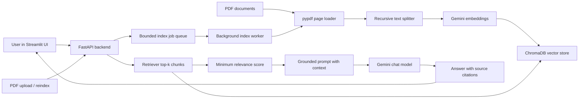

# End-to-End GenAI Knowledge Base (RAG)

[](https://github.com/idevelopAI/genai-knowledge-base/actions/workflows/ci.yml)

A containerized Retrieval-Augmented Generation system for asking questions over
internal PDF documents. The project combines a FastAPI backend, direct `pypdf`
document loading, LangChain integrations, ChromaDB, Google Gemini models, and a
Streamlit chat UI.

The system covers document ingestion, vector search, grounded answer
generation, API access, Docker-based packaging, CI checks, and an Azure
Terraform infrastructure draft.

The Streamlit UI and sample questions use German because the included sample
documents and demo workflow are German-focused.

## Why This Project Matters

Companies often have useful information locked inside PDFs, manuals, policies,
and internal guides. This project turns those documents into a searchable
knowledge base where users can ask natural language questions and receive
context-grounded answers with source references.

## Architecture



## Screenshots

Chat answers include expandable source citations:


The sidebar supports document discovery, PDF upload, and manual reindexing:


## Tech Stack

- Backend: Python, FastAPI, Pydantic
- RAG: pypdf, LangChain integrations, ChromaDB, Google Gemini
- Frontend: Streamlit
- DevOps: Docker, GitHub Actions
- Infrastructure: Terraform for an Azure deployment draft

## Tradeoffs

- ChromaDB keeps the local setup simple: it runs locally, persists embeddings on
  disk, and avoids external database setup while still showing real vector
  retrieval behavior.
- Google Gemini is used for both embeddings and answer generation to keep the
  model stack consistent and easy to configure through environment variables.
- In production, the vector store should move to managed infrastructure with
  backups, access controls, monitoring, and a clear migration path for schema or
  embedding-model changes.
- Local vector storage is convenient for demos, but it does not solve multi-user
  concurrency, centralized persistence, auditability, or horizontal scaling.
- The built-in rate limiter is process-local. For production with multiple app
  instances, use shared infrastructure such as Redis, API Management, or an
  ingress-level rate limiter.
- Index jobs run in a bounded, process-local worker queue. This keeps local
  requests responsive, but production deployments need a durable shared queue.
- The response cache and provider circuit breaker are also process-local. A
  multi-instance deployment needs shared cache and circuit state.
- Relevance scores are retrieval heuristics, not calibrated confidence
  probabilities. The cutoff should be tuned against representative evaluation
  questions whenever the documents or embedding model change.

## Features

- Ingests PDFs from the local `data/` folder.
- Supports PDF upload and reindexing from the Streamlit UI.
- Validates PDF structure and enforces configurable file-size and page limits.
- Stores document chunks in a local ChromaDB vector database.
- Rebuilds indexes through versioned collections so a failed build does not
  replace the active index.
- Runs upload and reindex operations asynchronously with job-status polling.
- Exposes a FastAPI `/ask` endpoint for RAG answers.
- Returns source document names, page numbers, and excerpts with each answer.
- Prompts grounded answers to include inline `[Source N]` evidence markers and
  normalizes missing or invalid markers against the retrieved source list.
- Refuses without calling the LLM when retrieval returns no usable context.
- Filters retrieved chunks by a configurable minimum relevance score and
  refuses when none pass.
- Treats retrieved document text as untrusted data in the system prompt.
- Provides a Streamlit chat interface for interactive use.
- Includes deterministic retrieval smoke checks and live RAG evaluation cases.
- Includes Docker packaging and a GitHub Actions CI workflow.
- Supports optional bearer-token API protection with `RAG_API_TOKEN`.
- Includes configurable in-memory rate limiting for expensive API routes.
- Adds `X-Request-ID` headers for request tracing across API responses and
  logs.
- Logs request timing, retrieval timing, LLM timing, and indexing metrics.
- Runs blocking embedding and chat calls in FastAPI's worker threadpool and
  bounds Gemini request duration and retries.
- Caches repeated answers by question, active index revision, model, and
  retrieval settings to avoid unnecessary provider calls.
- Opens a temporary provider circuit after repeated transient failures and
  allows one half-open recovery probe after the cooldown.
- Keeps secrets out of tracked code and Docker build context.

## Current Scope

This repository provides a complete local RAG workflow. It is not yet intended
for production workloads that require distributed storage, horizontal scaling,
or managed cloud operations.

Current hardening work includes:

- API health check.
- Safe API error responses.
- Configurable model, vector store, and retrieval settings.
- Basic test coverage and CI validation.
- Source-cited RAG responses.
- PDF upload and reindex workflow.
- JSONL-driven deterministic retrieval and live RAG eval checks.
- Optional API token protection.
- Configurable in-memory rate limiting.
- Structured observability logs for RAG and indexing paths.
- Request IDs for correlating client errors, server logs, and API responses.
- Transactional index activation and upload rollback on indexing failure.
- Bounded, parser-validated PDF uploads and concurrent rebuild protection.
- Bounded background indexing jobs with queued, running, completed, and failed
  states.
- TTL/LRU answer caching and quota-aware provider circuit breaking.

Planned improvements:

- Complete Azure container deployment settings.
- Replace in-memory rate limiting with shared infrastructure for multi-instance
  deployments.
- Replace process-local index jobs with a durable shared queue for
  multi-instance deployments.
- Add a pluggable generation-provider interface and optional local fallback.

## Local Setup

Create a virtual environment and install dependencies:

```bash
python -m venv .venv
source .venv/bin/activate
pip install -r requirements.lock.txt
```

`requirements.txt` lists the direct project dependencies. `requirements.lock.txt`
pins the full resolved dependency set used by CI and Docker for reproducibility.

To refresh the lock file after dependency changes:

```bash
pip install -r requirements.txt
pip freeze > requirements.lock.txt
```

Create a local `.env` file from the safe example file, then add your real API
key only in your local `.env` file:

```bash
cp example.env .env
```

Run ingestion to build the local vector database:

```bash
python ingest.py
```

Load the local environment variables and start the backend:

```bash
set -a
source .env
set +a
uvicorn main:app --reload
```

Start the frontend in a second terminal:

```bash
streamlit run frontend.py
```

The Streamlit sidebar lets you upload a PDF, rebuild the index, and see the
documents currently available to the backend.

PDF uploads default to a 10 MiB file limit and a 200-page limit. Override them
with `RAG_MAX_UPLOAD_BYTES` and `RAG_MAX_PDF_PAGES`.
`RAG_MAX_INDEX_JOBS` controls the number of retained or active local jobs and
defaults to 100.
`RAG_MIN_RELEVANCE_SCORE` controls the `0..1` scored-retrieval cutoff and
defaults to `0.65`. Reindex once after upgrading so the active collection uses
cosine distance consistently.
`GEMINI_REQUEST_TIMEOUT_SECONDS` defaults to `45`, and `GEMINI_MAX_RETRIES`
defaults to `1`, keeping upstream failures within the frontend request window.
`RAG_CACHE_TTL_SECONDS=300` and `RAG_CACHE_MAX_ENTRIES=256` configure the
process-local answer cache; set either to `0` to disable it.
`RAG_CIRCUIT_FAILURE_THRESHOLD=3` and `RAG_CIRCUIT_RECOVERY_SECONDS=60`
configure the provider circuit breaker.

## Demo Script

After starting the app, try this flow:

1. Open `http://localhost:8501`.
2. Confirm the sidebar lists the PDFs from `data/`.
3. Ask this German sample question: `Welche Informationen stehen im Dokument?`
4. Expand the German `Quellen` section under the answer and check the source
   filename/page.
5. Upload another PDF from the sidebar, click the German
   `Hochladen und indexieren` button, then ask a question about the new
   document.
6. Run `python evals/run_retrieval_eval.py` for credential-free retrieval
   checks.
7. Run `python evals/run_eval.py` while the backend is running for live RAG
   checks.

## Docker

Run both the backend and frontend with Docker Compose:

```bash
docker compose up --build
```

Compose passes the complete local environment only to the backend. The
frontend receives the backend URLs and optional `RAG_API_TOKEN`, but not the
Gemini API key.

Then open:

```text
http://localhost:8501
```

Build only the backend image:

```bash
docker build -t rag-backend:latest .
```

Run the backend with local environment variables:

```bash
docker run --rm --env-file .env -p 8000:8000 rag-backend:latest
```

Then start the Streamlit frontend locally:

```bash
streamlit run frontend.py
```

## Evaluation

Run the deterministic PDF extraction, chunking, source, and context checks:

```bash
python evals/run_retrieval_eval.py
```

This suite reads `evals/retrieval_cases.jsonl`, uses the production chunk sizes,
and performs deterministic lexical ranking over the committed PDFs. It runs in
CI without API credentials and acts as an ingestion/retrieval smoke test. It is
not a replacement for vector or model-quality evaluation.

For the live end-to-end suite, start the application and run:

```bash
python evals/run_eval.py
```

The live runner reads `evals/questions.jsonl`, sends each question to `/ask`,
and checks answer terms, source names, source excerpts, refusal behavior, and
inline `[Source N]` citations for grounded-answer cases. It uses
`RAG_API_TOKEN` from the process environment when API authentication is enabled.

Calibrate the scored-retrieval cutoff against the same labeled cases:

```bash
python evals/calibrate_relevance.py
```

The calibration runner embeds each evaluation question, compares candidate
thresholds, and reports false accepts, false refusals, and a recommended
cutoff. It does not call the chat model. Treat the result as a dataset-specific
baseline and rerun it after changing documents, chunking, or embedding models.
For the committed two-document corpus and balanced ten-case dataset, the latest
calibration selected `0.65` with no false accepts or false refusals.

## API

If `RAG_API_TOKEN` is set, protected endpoints require:

```text
Authorization: Bearer <RAG_API_TOKEN>
```

The expensive endpoints are rate-limited by default using
`RAG_RATE_LIMIT_REQUESTS=60` per `RAG_RATE_LIMIT_WINDOW_SECONDS=60`. Set
`RAG_RATE_LIMIT_REQUESTS=0` to disable this locally.

`RAG_MIN_RELEVANCE_SCORE` filters the top `RAG_TOP_K` candidates before prompt
construction. Higher values refuse more aggressively; calibrate the value with
`python evals/run_eval.py` instead of treating it as model confidence.

Every API response includes an `X-Request-ID` header. Clients can send their own
`X-Request-ID` value, or the API will generate one automatically. The same value
is included in structured logs to make debugging easier.

Health check:

```bash
curl http://127.0.0.1:8000/health
```

Ask a German sample question:

```bash
curl -X POST http://127.0.0.1:8000/ask \
  -H "Content-Type: application/json" \
  -d '{"question": "Welche Informationen stehen im Dokument?"}'
```

List available documents:

```bash
curl http://127.0.0.1:8000/documents
```

Upload and index a PDF:

```bash
curl -X POST http://127.0.0.1:8000/documents \
  -F "file=@data/sample_document.pdf"
```

Rebuild the index from all PDFs in `data/`:

```bash
curl -X POST http://127.0.0.1:8000/reindex
```

Uploads and reindex requests return HTTP `202 Accepted` with a job resource:

```json
{
  "job_id": "8f84484f-19d6-4d9e-a662-dc952f16ee40",
  "operation": "upload",
  "status": "queued",
  "request_id": "5a56c4c2-851f-46db-bd72-a6d5fb30e6fb",
  "filename": "sample_document.pdf",
  "result": null,
  "error": null,
  "created_at": "2026-07-15T12:00:00+00:00",
  "updated_at": "2026-07-15T12:00:00+00:00"
}
```

Poll the URL from the `Location` response header until the job is completed or
failed:

```bash
curl http://127.0.0.1:8000/jobs/8f84484f-19d6-4d9e-a662-dc952f16ee40
```

Example `/ask` response shape:

```json
{
  "answer": "Antwort basierend auf dem gefundenen Kontext.",
  "sources": [
    {
      "source": "sample_document.pdf",
      "page": 1,
      "excerpt": "Relevant retrieved text..."
    }
  ]
}
```

## Security

- Real secrets must stay in local environment variables or `.env`.
- `.env` and `.env.*` are ignored by Git and Docker.
- `example.env` contains placeholder values only.
- Set `RAG_API_TOKEN` to require bearer-token access for `/ask`, `/documents`,
  `/reindex`, and `/jobs/{job_id}`.
- `RAG_RATE_LIMIT_REQUESTS` and `RAG_RATE_LIMIT_WINDOW_SECONDS` limit repeated
  calls to `/ask`, `/documents`, and `/reindex`.
- `RAG_MAX_UPLOAD_BYTES` and `RAG_MAX_PDF_PAGES` bound uploaded PDF processing.
- Uploaded files are parser-validated and removed if indexing fails.
- Index rebuilds activate a new version only after embedding succeeds; the
  previous collection remains active on failure.
- API errors avoid returning raw internal exception text to users.
- Transient model-provider failures return HTTP `503` with `Retry-After`
  instead of being reported as internal application failures.
- Questions are trimmed, reject blank input, and are limited to 2,000
  characters.
- Retrieved document instructions are explicitly treated as untrusted data;
  empty retrieval results return a deterministic refusal without an LLM call.
- Low-scoring retrieval results are excluded before prompt construction.
- Bearer tokens are compared in constant time and represented only by a hashed
  fingerprint in rate-limiter state and logs.

If a real API key is ever committed, rotate the key immediately and remove it
from Git history.

## Observability

The API logs structured events for the important paths:

- `rag_question_answered`: question length, candidate/source counts, relevance
  threshold and best score, retrieval time, LLM time, total request time, and
  request ID.
- `rag_index_rebuilt`: PDF count, loaded pages, generated chunks, and indexing
  time, plus request ID when triggered through the API.
- `rag_document_uploaded`: saved filename, upload size, page count, resulting
  PDF count, chunk count, total upload/index time, and request ID.
- `rag_index_job_failed`: job ID, operation, safe error message, and request ID.
- `rag_rate_limited`: client key, configured limit, window size, and retry delay
  when a request receives HTTP 429, plus request ID.
- `rag_cache_hit` and `rag_cache_miss`: whether a provider call was avoided for
  a question, without logging the question text.
- `rag_provider_circuit_rejected`: requests rejected during provider cooldown,
  including the retry delay.
- `http_request_completed`: method, path, status code, elapsed time, and request
  ID for every API request.

Use `LOG_LEVEL=INFO` locally or in deployment to keep these metrics visible.

## CI

GitHub Actions validates the project by installing dependencies, running unit
tests and deterministic retrieval checks, and building the Docker image.

## Dependency Management

- `requirements.txt` contains direct dependencies that describe what the project
  intentionally uses.
- `requirements.lock.txt` pins the full resolved environment used by CI and
  Docker.
- Direct PDF extraction uses `pypdf`; the project depends only on the LangChain
  integration packages it imports instead of the umbrella and community
  packages.
- After changing direct dependencies, regenerate the lock file with
  `pip freeze > requirements.lock.txt` from a freshly installed environment.

## Terraform

The `terraform/` folder contains an Azure infrastructure draft for the future
deployment path. Before production use, it should be extended with container
image settings, secret management, managed identity, and deployment outputs.

## Security

Report suspected vulnerabilities privately as described in
[`SECURITY.md`](SECURITY.md). Do not include credentials or internal documents
in public issues.

## License

This project is available under the [MIT License](LICENSE).
