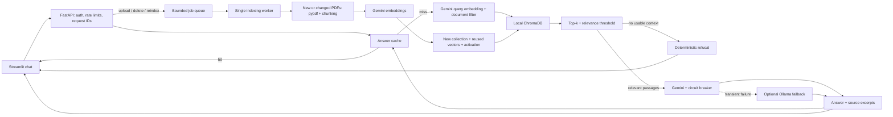

# GenAI Knowledge Base

[](https://github.com/idevelopAI/genai-knowledge-base/actions/workflows/ci.yml)

Ask questions about PDF documents and inspect the passages behind each answer.
A local RAG application built with **FastAPI, Streamlit, ChromaDB, and Google
Gemini**, with optional Ollama fallback for answer generation.


The interface is German; the documentation is English. The screenshot uses the
included sample PDF and a fixed response to illustrate the interface.

## Quick Start

Requires Docker with Compose and a Google API key with access to the configured
chat and embedding models.

1. Create your local configuration without overwriting an existing file:

   ```bash
   cp -n example.env .env
   ```

2. Set `GOOGLE_API_KEY` in your local `.env`. Optionally set `RAG_API_TOKEN` to
   protect the API. Never commit either secret.
3. Start both services:

   ```bash
   docker compose up --build
   ```

4. Open [the chat](http://127.0.0.1:8501). On the first run, open **Verwalten**
   in the sidebar and click **Index neu erstellen**. Wait for indexing to finish.

Two sample PDFs are included. Uploading another PDF also rebuilds the index.
Existing documents and embeddings persist in `data/` and `chroma_db/`.
Stop the services with `docker compose down`; this does not delete those folders.

Compose publishes both services on `127.0.0.1` only. The frontend receives the
API token and backend URLs, not the Google API key.

## Using the App

- **Document scope:** choose the PDFs to search in **Suchbereich**. Clearing the
  selection disables questions; it never silently switches to all documents.
- **Upload:** open **Hochladen**, choose a PDF, and click **Hochladen & indexieren**.
  Indexing runs in the background, with status shown in the sidebar.
- **Answers:** expand **Quellen** to inspect filenames, page numbers, and excerpts.
  **Quelle öffnen** opens the cited page, with page selection and a PDF download.
  Replaced or deleted sources are reported instead of showing a different file.
  The header includes controls to start a new chat or download it as Markdown.
- **Delete:** open **Verwalten**, select a PDF, and confirm **Dokument löschen**.
  Deletion rebuilds the remaining index; the last document cannot be deleted.
- **Index status:** API connectivity and index readiness are shown separately.
  Empty, outdated, or unavailable indexes disable questions, including cached answers.

File changes run inside one indexing worker. Queued uploads stay outside the
active PDF set, and a queued deletion does not remove its PDF early. Failed
rebuilds retain the previous index and roll back the current job's file change.
Successful indexing clears the answer cache and the current browser session's
chat. Other open sessions may still display their earlier answers.

<details>
<summary>Upload interface</summary>


</details>

### Demo Script

1. Index the included PDFs and select only `sample_document.pdf`.
2. Ask: `Wie funktioniert Retrieval-Augmented Generation?`
3. Expand the sources, click **Quelle öffnen**, and compare the cited PDF page.
4. Repeat the question to exercise the answer cache.
5. Upload a non-sensitive PDF, wait for completion, select it, and ask a specific
   question about its content.
6. Delete that PDF and verify the remaining documents are still available.

## Architecture



Retrieval uses cosine similarity and `source_name` metadata filters. Chunks below
the relevance cutoff are excluded before generation. The model is instructed to
use only retrieved context and include `[Source N]` references; source markers
are checked against the retrieved source list.

## Configuration

See [`example.env`](example.env) for all supported settings. Restart the services
after changing configuration. Model availability and quotas depend on your
Google account; change model IDs if a configured model is unavailable.

| Setting | Default | Purpose |
| --- | --- | --- |
| `GOOGLE_API_KEY` | Required | Gemini embeddings and generation |
| `RAG_API_TOKEN` | Unset | Optional bearer-token authentication |
| `RAG_TOP_K` / `RAG_MIN_RELEVANCE_SCORE` | `3` / `0.65` | Candidate count and relevance cutoff |
| `RAG_CHUNK_SIZE` / `RAG_CHUNK_OVERLAP` | `1000` / `200` | Text splitting |
| `RAG_MAX_UPLOAD_BYTES` / `RAG_MAX_PDF_PAGES` | `10485760` / `200` | 10 MiB and 200-page PDF limits |
| `RAG_MAX_INDEX_JOBS` | `100` | Bounded local job store |
| `RAG_CACHE_TTL_SECONDS` / `RAG_CACHE_MAX_ENTRIES` | `300` / `256` | Answer cache; either `0` disables it |
| `RAG_RATE_LIMIT_REQUESTS` / `RAG_RATE_LIMIT_WINDOW_SECONDS` | `60` / `60` | Requests per window; requests `0` disables it |
| `RAG_CIRCUIT_FAILURE_THRESHOLD` / `RAG_CIRCUIT_RECOVERY_SECONDS` | `3` / `60` | Provider failures before cooldown |
| `GEMINI_REQUEST_TIMEOUT_SECONDS` / `GEMINI_MAX_RETRIES` | `45` / `1` | Primary generation request settings |
| `RAG_REQUEST_TIMEOUT_SECONDS` | Automatic | Frontend read-timeout override |

The frontend takes its read timeout from the backend: at least 180 seconds,
allowing for configured primary attempts, optional fallback, and a 60-second
retrieval/network margin. This is a client wait budget, not an end-to-end server
deadline. Increase the override for slower local models or retrieval.

Reindex after changing the embedding model or chunk settings. Existing indexes
without build metadata also need a one-time rebuild after upgrading. The app
compares content fingerprints and build settings against the active collection;
it does not automatically rebuild or consume embedding quota. After an external
CLI rebuild, restart the backend to load the new collection.
Rebuilds are incremental: PDFs whose filename and content hash match the active
collection keep their stored embeddings, so uploads and deletions only embed new
or changed files. Changing the embedding model or chunk settings re-embeds
everything; `python ingest.py --full` forces that without a settings change.
Health checks stream-hash the local PDFs without relying on timestamps; this
favors correctness for a small corpus, but adds disk reads as the corpus grows.

### Optional Ollama Fallback

With Ollama installed and running, download a model:

```bash
ollama pull gemma3:4b
```

Set these values in your local configuration and restart the backend:

```dotenv
RAG_OLLAMA_FALLBACK_ENABLED=true
OLLAMA_CHAT_MODEL=gemma3:4b
OLLAMA_BASE_URL=http://host.docker.internal:11434
```

Use `http://127.0.0.1:11434` instead when the backend runs outside Docker.
The container must be able to reach the host's Ollama service. Do not expose
Ollama to an untrusted network just to enable fallback.

Fallback handles transient Gemini generation failures, including timeouts,
quota responses, selected server errors, and an open circuit.
**This is not an offline mode:** indexing and query embeddings still use Google.
An embedding quota failure can prevent retrieval before Ollama is reached.

## Local Development

Use Python 3.11, matching CI and Docker:

```bash
python3.11 -m venv .venv
source .venv/bin/activate
python -m pip install -r requirements.lock.txt
```

Create and configure `.env` as described above. In the backend terminal:

```bash
source .venv/bin/activate
set -a
source .env
set +a
uvicorn main:app --reload --host 127.0.0.1 --port 8000
```

In a second terminal, export the same local configuration so API authentication
also works from the frontend:

```bash
source .venv/bin/activate
set -a
source .env
set +a
streamlit run frontend.py --server.address 127.0.0.1
```

Build the first index from the sidebar. Alternatively, `python ingest.py` builds
it from the command line; do not run CLI ingestion concurrently with API jobs.

## Tests and Evaluation

```bash
python -m pytest
python evals/run_retrieval_eval.py
```

CI runs both commands and builds the Docker image without model credentials.
Tests cover the API, upload/deletion jobs, cache and circuit behavior, document
filters, and Streamlit interactions.

The deterministic retrieval suite checks PDF extraction, chunking, lexical
ranking, and expected source/context matches. It is a smoke test, **not** a
measurement of embedding quality or generated-answer correctness.

With the API running and configuration exported, the optional live checks are:

```bash
python evals/run_eval.py
python evals/calibrate_relevance.py
```

These consume Google quota. Calibration uses embeddings without chat generation;
the live suite checks answers, citations, sources, and refusals against the
cases in `evals/`. Run them manually after retrieval or model changes.

### Dependencies

[`requirements.txt`](requirements.txt) lists direct dependencies;
[`requirements.lock.txt`](requirements.lock.txt) pins the resolved versions used
by CI and Docker. To update dependencies, install the direct requirements into
a fresh Python 3.11 environment, run the tests, and regenerate the lock with
`python -m pip freeze > requirements.lock.txt`. Review the diff before committing.

## API and Diagnostics

Interactive API documentation: [Swagger UI](http://127.0.0.1:8000/docs).
When `RAG_API_TOKEN` is configured, protected endpoints require
`Authorization: Bearer <token>`.

| Method | Endpoint | Purpose |
| --- | --- | --- |
| `GET` | `/health` | Public readiness/configuration summary |
| `POST` | `/ask` | Question with optional `documents` filename list |
| `GET` | `/documents` | Available PDF filenames |
| `GET` | `/documents/{filename}` | Page count and content revision |
| `GET` | `/documents/{filename}/pages/{page}` | One-based page preview as PNG |
| `GET` | `/documents/{filename}/file` | Original PDF download |
| `POST` | `/documents` | Multipart PDF upload and indexing job |
| `DELETE` | `/documents/{filename}` | Deletion and indexing job |
| `POST` | `/reindex` | Rebuild the index |
| `GET` | `/jobs/{job_id}` | Job status and result |

Upload, deletion, and reindex return `202 Accepted`. Poll the `Location` header
until the job is `completed` or `failed`. `/ask` returns an `answer` and `sources`
containing filenames, one-based page numbers, excerpts, and content revisions.
Preview and download routes honor the same authentication and rate limits as
document operations. Pass the source's `revision` as a query parameter to reject
a changed file with `409`; missing documents return `404`. Responses use
`Cache-Control: no-store`. Streamlit fetches them server-side, without putting
API tokens in browser URLs. Page rendering uses pypdfium2, with a 1,600-pixel
maximum edge and serialized PDFium calls. Upload size/page limits also apply.

`/health` stays `200` when the API is reachable. `model_configured` and
`index_state` describe local readiness; `rag_ready` requires a current index.
States include `empty`, `needs_rebuild`, `needs_reload`, `building`,
`unconfigured`, and `unavailable`; `index_reason` explains rebuild/reload needs.
These checks do not call Gemini or verify provider quota.

Every API response carries `X-Request-ID`. Use it to correlate UI errors with
logs (`docker compose logs backend`). Events include retrieval/generation
timing, source counts, cache hits/misses, indexing progress, provider fallback,
and circuit state. Normal timing/cache events omit question and answer text;
inspect exception logs before sharing them because third-party errors may
contain additional details. Transient provider errors return `503` and
`Retry-After`; the app's request limiter returns `429`.

## Tradeoffs and Limitations

- **ChromaDB:** simple local persistence without a separate database service.
  This setup is single-instance, not distributed storage or a backup solution.
- **Gemini:** one provider for embeddings and generation, configurable models,
  and a small integration surface. Availability, cost, and rate limits remain
  external dependencies. Only new or changed PDFs consume embedding quota; a
  settings change or `--full` rebuild embeds the whole corpus.
- **In-memory state:** jobs, cache, circuit state, and rate limits are local to
  one backend process. Jobs are not durable across restarts; avoid stopping the
  service during indexing and back up PDFs before bulk changes. On startup, the
  backend restores PDFs from interrupted deletions and removes staged uploads;
  an interrupted upload that already reached `data/` stays and needs a rebuild.
- **Answer quality:** similarity scores are not confidence probabilities.
  Citation presence does not prove a claim is supported. Prompt-injection
  instructions reduce risk but do not guarantee resistance to hostile PDFs.
  Chat history is displayed but not sent as conversation memory to `/ask`.
- **PDF support:** retrieval uses text extraction; scanned/image-only PDFs need
  OCR first. Page previews are raster images, not a sandbox for hostile PDFs.
- **Production changes:** use durable jobs, shared cache/rate limits, managed
  storage with backups, user-level access control, TLS, and deployment monitoring.

## Security and Data Handling

Keep this app local unless you add frontend authentication and a deployment
security boundary. The optional API token is **not** a Streamlit login: anyone
who can access the UI can use its configured backend credentials.

- `.env`, local vector data, Streamlit secrets, and additional PDFs under `data/`
  are excluded from Git and Docker builds. Only the two sample PDFs are
  allowlisted; do not replace their contents with private documents.
- Gemini receives document text for embeddings and retrieved passages plus the
  question for generation. Ollama fallback receives the retrieved context and
  question at the configured endpoint. Upload only data you may share with those
  providers.
- Upload validation, size/page limits, filename checks, and authentication reduce
  risk; they are not a sandbox for arbitrary untrusted documents.
- Chat exports and screenshots can contain document text. Review them before
  sharing. Rotate any credential that was exposed, even after removing it from
  the repository.

Report vulnerabilities privately using [`SECURITY.md`](SECURITY.md).

## Terraform

[`terraform/`](terraform/) contains an **Azure infrastructure draft**, not a
complete deployment. It is independent of local startup. Container-image
configuration, secret management, managed identity, and deployment outputs
still need implementation and validation before use.

## License

[MIT](LICENSE).
